# Olá, eu sou o Karidson 👋

Desenvolvedor entusiasta, estudante de Engenharia Civil e apaixonado por tecnologia, automação e inovação.

🌐 [karidsonbessa.com](https://www.karidsonbessa.com) · 💼 [LinkedIn](https://www.linkedin.com/in/karidsonbessa/)

<picture>
  <source media="(prefers-color-scheme: dark)" srcset="https://raw.githubusercontent.com/karidson/karidson/cards/about-dark.svg">
  
</picture>
<picture>
  <source media="(prefers-color-scheme: dark)" srcset="https://raw.githubusercontent.com/karidson/karidson/cards/summary-dark.svg">
  
</picture>

<picture>
  <source media="(prefers-color-scheme: dark)" srcset="https://raw.githubusercontent.com/karidson/karidson/cards/languages-dark.svg">
  
</picture>
<picture>
  <source media="(prefers-color-scheme: dark)" srcset="https://raw.githubusercontent.com/karidson/karidson/cards/weekly-dark.svg">
  
</picture>

<picture>
  <source media="(prefers-color-scheme: dark)" srcset="https://raw.githubusercontent.com/karidson/karidson/cards/repos-dark.svg">
  
</picture>

Cartões gerados automaticamente com [github-cool-readme](https://github.com/pedrocatalao/github-cool-readme).
